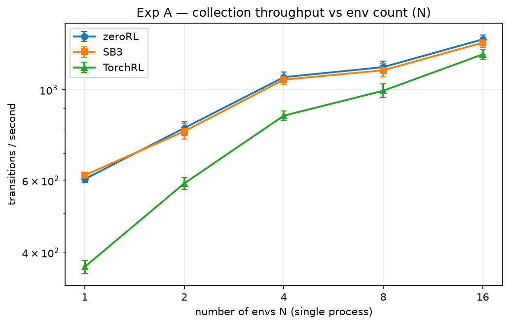
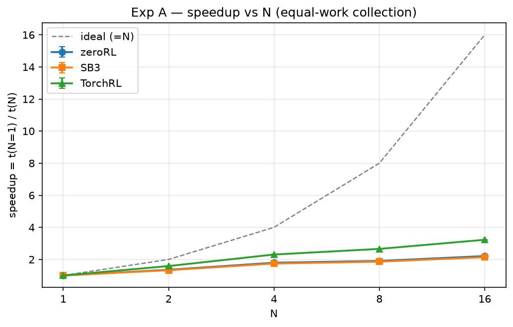
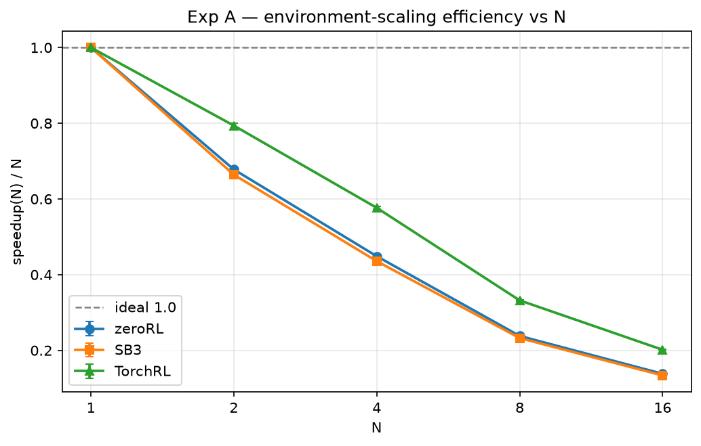
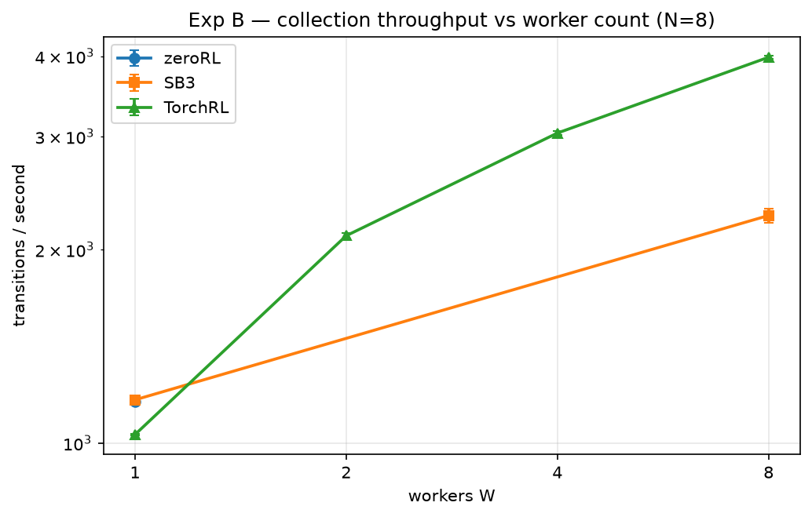
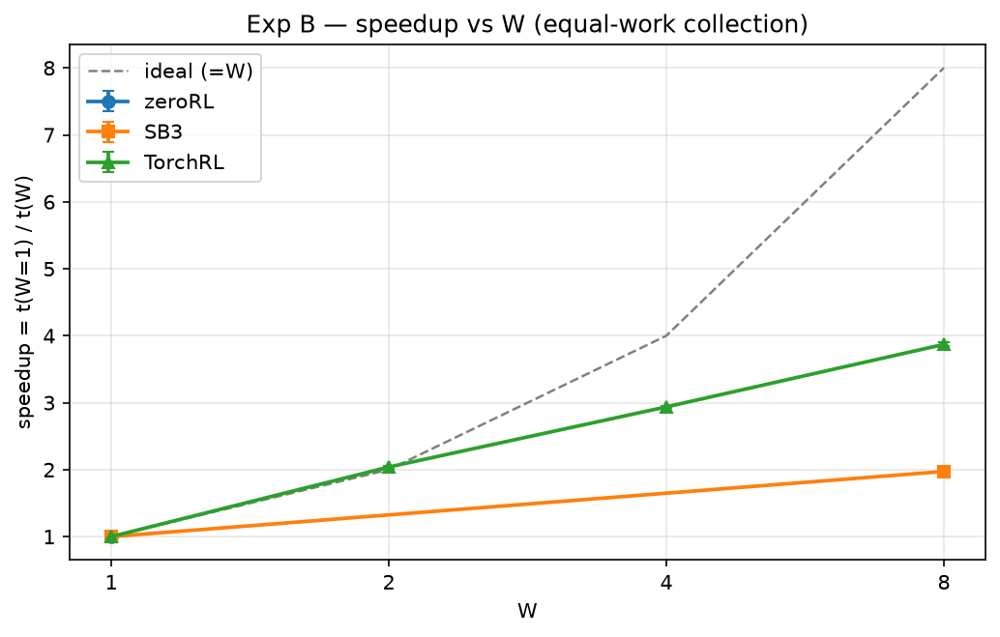
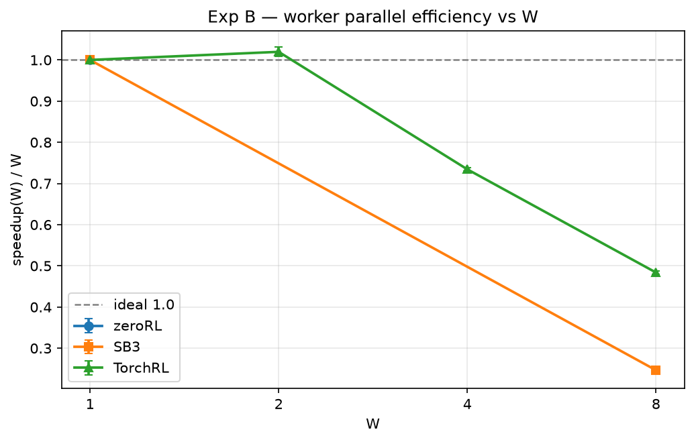
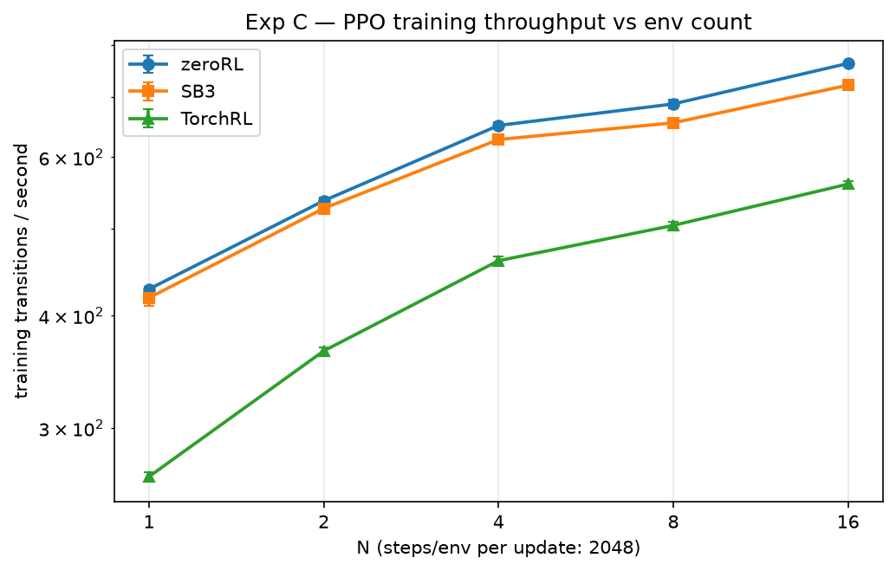
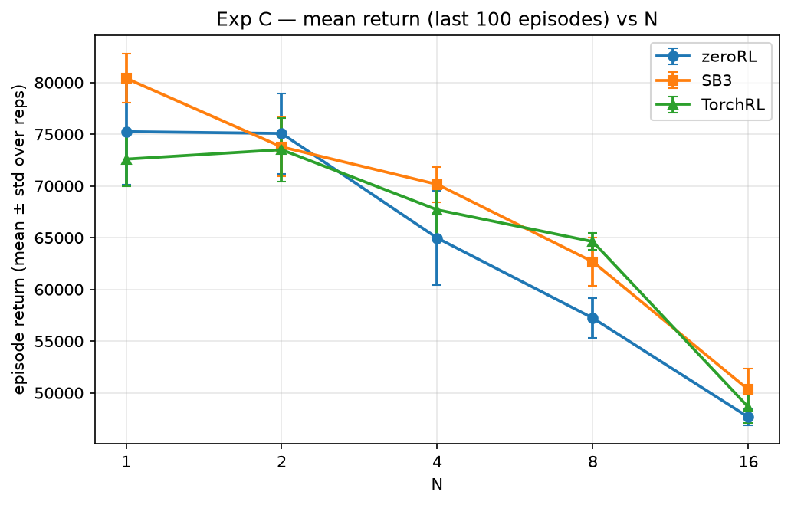

# Scalability benchmark report

Generated: 2026-11-07T19:17:21.500812+00:00 · rows: 425 · figures in `figures/`

## Environment

| key | value |
| --- | --- |
| python | 3.13.14 |
| platform | Linux-6.8.12-tegra-aarch64-with-glibc2.39 |
| processor | aarch64 |
| device | cpu |
| hostname | gpu1 |
| torch | 2.13.0+cu130 |
| torch_num_threads | 14 |
| cuda_available | True |
| gymnasium | 1.3.0 |
| sb3 | 2.9.0 |
| torchrl | 0.14.1 |
| tensordict | 0.14.3 |
| git_sha | 7813ea3a3711cfbcf6592ef8af5bb05b04fb4dc4 |

## Methodology (summary)

- Frameworks: zeroRL (this repo, official `rollout_phase` / `BaseTrain.train()`), Stable-Baselines3, TorchRL — same shared-trunk policy/weights where policies apply (see `policy_reference.py`).
- Experiments A/B count individual env transitions with a warmup of 16,000 (excluded) + 100,000 measured transitions per run; Experiments C/D train PPO for exactly 262,144 transitions per run.
- Repetitions: 5 seeds per cell for A/B, 3 for C/D; every reported statistic aggregates **all** ok repetitions (mean ± std), never best-of.
- Metrics: `throughput = measured / measure_seconds`, `speedup(N) = t(baseline) / t(N)`, `environment_scaling_efficiency(N) = speedup(N) / N`, `worker_parallel_efficiency(W) = speedup(W) / (W / 1)`.
- Phase timing: `init` = env + policy construction + weight load (+ TorchRL collector/worker spawn); `warmup` (A/B only, excluded); `boundary` (A/B only) = warmup→measure phase reset / collector-worker restart, timed as `boundary_seconds`; `measure` = the official training/collection steady state. Full framework-specific details in `INSPECTION.md`.
- Device: CPU (`CUDA_VISIBLE_DEVICES=""`); protocol C/D hyperparameters in `ppo_protocols.py` (lr 3e-4 linear-decay, gamma .99, gae_lambda .95, clip .2, entropy .01, value .5, epochs 10, batch 64, grad-clip .5).

## Experiment A — environment scaling (collection) [humanoidstandupv5]

| framework | N | throughput (trans/s) | mean time (s) | speedup (paired) | env-scaling efficiency (paired) | pairs (n) |
| --- | --- | --- | --- | --- | --- | --- |
| zeroRL | 1 | 605.0 ± 11.0 | 165.33 | 1.00 | 1.00 | 5 |
| zeroRL | 2 | 806.7 ± 31.4 | 124.14 | 1.36 ± 0.01 | 0.68 ± 0.01 | 5 |
| zeroRL | 4 | 1,074.0 ± 32.2 | 93.19 | 1.79 ± 0.01 | 0.45 ± 0.00 | 5 |
| zeroRL | 8 | 1,136.9 ± 38.2 | 88.06 | 1.91 ± 0.02 | 0.24 ± 0.00 | 5 |
| zeroRL | 16 | 1,329.3 ± 33.9 | 75.28 | 2.21 ± 0.01 | 0.14 ± 0.00 | 5 |
| SB3 | 1 | 618.6 ± 10.1 | 161.71 | 1.00 | 1.00 | 5 |
| SB3 | 2 | 791.7 ± 34.1 | 126.52 | 1.33 ± 0.01 | 0.66 ± 0.00 | 5 |
| SB3 | 4 | 1,059.2 ± 29.9 | 94.48 | 1.74 ± 0.01 | 0.44 ± 0.00 | 5 |
| SB3 | 8 | 1,116.7 ± 41.6 | 89.67 | 1.86 ± 0.01 | 0.23 ± 0.00 | 5 |
| SB3 | 16 | 1,304.4 ± 33.7 | 76.71 | 2.14 ± 0.01 | 0.13 ± 0.00 | 5 |
| TorchRL | 1 | 369.2 ± 14.1 | 271.25 | 1.00 | 1.00 | 5 |
| TorchRL | 2 | 590.6 ± 19.1 | 169.50 | 1.59 ± 0.01 | 0.79 ± 0.01 | 5 |
| TorchRL | 4 | 864.7 ± 22.6 | 115.72 | 2.31 ± 0.02 | 0.58 ± 0.00 | 5 |
| TorchRL | 8 | 995.2 ± 38.1 | 100.61 | 2.66 ± 0.02 | 0.33 ± 0.00 | 5 |
| TorchRL | 16 | 1,221.5 ± 32.6 | 81.92 | 3.23 ± 0.02 | 0.20 ± 0.00 | 5 |

## Experiment B — worker scaling (collection, N=8) [humanoidstandupv5]

| framework | W | throughput (trans/s) | mean time (s) | speedup (paired) | worker parallel efficiency (paired) | pairs (n) |
| --- | --- | --- | --- | --- | --- | --- |
| zeroRL | 1 | 1,159.6 ± 6.7 | 86.24 | 1.00 | 1.00 | 5 |
| SB3 | 1 | 1,167.6 ± 3.3 | 85.65 | 1.00 | 1.00 | 5 |
| SB3 | 8 | 2,259.8 ± 57.7 | 44.28 | 1.97 ± 0.04 | 0.25 ± 0.01 | 5 |
| TorchRL | 1 | 1,030.9 ± 3.2 | 97.01 | 1.00 | 1.00 | 5 |
| TorchRL | 2 | 2,101.8 ± 20.2 | 47.58 | 2.04 ± 0.02 | 1.02 ± 0.01 | 5 |
| TorchRL | 4 | 3,036.2 ± 24.0 | 32.94 | 2.94 ± 0.02 | 0.73 ± 0.00 | 5 |
| TorchRL | 8 | 3,983.5 ± 25.7 | 25.10 | 3.87 ± 0.03 | 0.48 ± 0.00 | 5 |

**Unsupported (recorded, not run)**:

- zeroRL W=2: zeroRL has no multi-process environment path (vectorize_env -> SyncVectorEnv only); W>=2 unsupported
- zeroRL W=2: zeroRL has no multi-process environment path (vectorize_env -> SyncVectorEnv only); W>=2 unsupported
- zeroRL W=2: zeroRL has no multi-process environment path (vectorize_env -> SyncVectorEnv only); W>=2 unsupported
- zeroRL W=2: zeroRL has no multi-process environment path (vectorize_env -> SyncVectorEnv only); W>=2 unsupported
- zeroRL W=2: zeroRL has no multi-process environment path (vectorize_env -> SyncVectorEnv only); W>=2 unsupported
- zeroRL W=4: zeroRL has no multi-process environment path (vectorize_env -> SyncVectorEnv only); W>=2 unsupported
- zeroRL W=4: zeroRL has no multi-process environment path (vectorize_env -> SyncVectorEnv only); W>=2 unsupported
- zeroRL W=4: zeroRL has no multi-process environment path (vectorize_env -> SyncVectorEnv only); W>=2 unsupported
- zeroRL W=4: zeroRL has no multi-process environment path (vectorize_env -> SyncVectorEnv only); W>=2 unsupported
- zeroRL W=4: zeroRL has no multi-process environment path (vectorize_env -> SyncVectorEnv only); W>=2 unsupported
- zeroRL W=8: zeroRL has no multi-process environment path (vectorize_env -> SyncVectorEnv only); W>=2 unsupported
- zeroRL W=8: zeroRL has no multi-process environment path (vectorize_env -> SyncVectorEnv only); W>=2 unsupported
- zeroRL W=8: zeroRL has no multi-process environment path (vectorize_env -> SyncVectorEnv only); W>=2 unsupported
- zeroRL W=8: zeroRL has no multi-process environment path (vectorize_env -> SyncVectorEnv only); W>=2 unsupported
- zeroRL W=8: zeroRL has no multi-process environment path (vectorize_env -> SyncVectorEnv only); W>=2 unsupported
- SB3 W=2: SB3 SubprocVecEnv runs exactly one process per env, so only W=1 (DummyVecEnv) and W=8 (SubprocVecEnv) exist; W=2 unsupported
- SB3 W=2: SB3 SubprocVecEnv runs exactly one process per env, so only W=1 (DummyVecEnv) and W=8 (SubprocVecEnv) exist; W=2 unsupported
- SB3 W=2: SB3 SubprocVecEnv runs exactly one process per env, so only W=1 (DummyVecEnv) and W=8 (SubprocVecEnv) exist; W=2 unsupported
- SB3 W=2: SB3 SubprocVecEnv runs exactly one process per env, so only W=1 (DummyVecEnv) and W=8 (SubprocVecEnv) exist; W=2 unsupported
- SB3 W=2: SB3 SubprocVecEnv runs exactly one process per env, so only W=1 (DummyVecEnv) and W=8 (SubprocVecEnv) exist; W=2 unsupported
- SB3 W=4: SB3 SubprocVecEnv runs exactly one process per env, so only W=1 (DummyVecEnv) and W=8 (SubprocVecEnv) exist; W=4 unsupported
- SB3 W=4: SB3 SubprocVecEnv runs exactly one process per env, so only W=1 (DummyVecEnv) and W=8 (SubprocVecEnv) exist; W=4 unsupported
- SB3 W=4: SB3 SubprocVecEnv runs exactly one process per env, so only W=1 (DummyVecEnv) and W=8 (SubprocVecEnv) exist; W=4 unsupported
- SB3 W=4: SB3 SubprocVecEnv runs exactly one process per env, so only W=1 (DummyVecEnv) and W=8 (SubprocVecEnv) exist; W=4 unsupported
- SB3 W=4: SB3 SubprocVecEnv runs exactly one process per env, so only W=1 (DummyVecEnv) and W=8 (SubprocVecEnv) exist; W=4 unsupported
- zeroRL W=2: zeroRL has no multi-process environment path (vectorize_env -> SyncVectorEnv only); W>=2 unsupported
- zeroRL W=2: zeroRL has no multi-process environment path (vectorize_env -> SyncVectorEnv only); W>=2 unsupported
- zeroRL W=2: zeroRL has no multi-process environment path (vectorize_env -> SyncVectorEnv only); W>=2 unsupported
- zeroRL W=2: zeroRL has no multi-process environment path (vectorize_env -> SyncVectorEnv only); W>=2 unsupported
- zeroRL W=2: zeroRL has no multi-process environment path (vectorize_env -> SyncVectorEnv only); W>=2 unsupported
- zeroRL W=4: zeroRL has no multi-process environment path (vectorize_env -> SyncVectorEnv only); W>=2 unsupported
- zeroRL W=4: zeroRL has no multi-process environment path (vectorize_env -> SyncVectorEnv only); W>=2 unsupported
- zeroRL W=4: zeroRL has no multi-process environment path (vectorize_env -> SyncVectorEnv only); W>=2 unsupported
- zeroRL W=4: zeroRL has no multi-process environment path (vectorize_env -> SyncVectorEnv only); W>=2 unsupported
- zeroRL W=4: zeroRL has no multi-process environment path (vectorize_env -> SyncVectorEnv only); W>=2 unsupported
- zeroRL W=8: zeroRL has no multi-process environment path (vectorize_env -> SyncVectorEnv only); W>=2 unsupported
- zeroRL W=8: zeroRL has no multi-process environment path (vectorize_env -> SyncVectorEnv only); W>=2 unsupported
- zeroRL W=8: zeroRL has no multi-process environment path (vectorize_env -> SyncVectorEnv only); W>=2 unsupported
- zeroRL W=8: zeroRL has no multi-process environment path (vectorize_env -> SyncVectorEnv only); W>=2 unsupported
- zeroRL W=8: zeroRL has no multi-process environment path (vectorize_env -> SyncVectorEnv only); W>=2 unsupported
- SB3 W=2: SB3 SubprocVecEnv runs exactly one process per env, so only W=1 (DummyVecEnv) and W=8 (SubprocVecEnv) exist; W=2 unsupported
- SB3 W=2: SB3 SubprocVecEnv runs exactly one process per env, so only W=1 (DummyVecEnv) and W=8 (SubprocVecEnv) exist; W=2 unsupported
- SB3 W=2: SB3 SubprocVecEnv runs exactly one process per env, so only W=1 (DummyVecEnv) and W=8 (SubprocVecEnv) exist; W=2 unsupported
- SB3 W=2: SB3 SubprocVecEnv runs exactly one process per env, so only W=1 (DummyVecEnv) and W=8 (SubprocVecEnv) exist; W=2 unsupported
- SB3 W=2: SB3 SubprocVecEnv runs exactly one process per env, so only W=1 (DummyVecEnv) and W=8 (SubprocVecEnv) exist; W=2 unsupported
- SB3 W=4: SB3 SubprocVecEnv runs exactly one process per env, so only W=1 (DummyVecEnv) and W=8 (SubprocVecEnv) exist; W=4 unsupported
- SB3 W=4: SB3 SubprocVecEnv runs exactly one process per env, so only W=1 (DummyVecEnv) and W=8 (SubprocVecEnv) exist; W=4 unsupported
- SB3 W=4: SB3 SubprocVecEnv runs exactly one process per env, so only W=1 (DummyVecEnv) and W=8 (SubprocVecEnv) exist; W=4 unsupported
- SB3 W=4: SB3 SubprocVecEnv runs exactly one process per env, so only W=1 (DummyVecEnv) and W=8 (SubprocVecEnv) exist; W=4 unsupported
- SB3 W=4: SB3 SubprocVecEnv runs exactly one process per env, so only W=1 (DummyVecEnv) and W=8 (SubprocVecEnv) exist; W=4 unsupported

## Experiment C — PPO training protocol (fixed 2048 steps/env per rollout) [humanoidstandupv5]

| framework | N | updates | throughput (trans/s) | mean time (s) | mean return (last 100) | reps |
| --- | --- | --- | --- | --- | --- | --- |
| zeroRL | 1 | 128 | 428.1 ± 2.5 | 612.4 | 75,253.6 ± 5,108.2 | 6 |
| zeroRL | 2 | 64 | 536.7 ± 4.2 | 488.4 | 75,079.7 ± 3,892.0 | 6 |
| zeroRL | 4 | 32 | 650.7 ± 5.7 | 402.9 | 64,966.9 ± 4,545.7 | 6 |
| zeroRL | 8 | 16 | 687.6 ± 7.3 | 381.3 | 57,229.6 ± 1,909.4 | 6 |
| zeroRL | 16 | 8 | 762.7 ± 4.1 | 343.7 | 47,649.0 ± 799.5 | 6 |
| SB3 | 1 | 128 | 418.7 ± 8.6 | 626.3 | 80,410.9 ± 2,362.9 | 6 |
| SB3 | 2 | 64 | 526.3 ± 5.7 | 498.2 | 73,775.3 ± 2,866.8 | 6 |
| SB3 | 4 | 32 | 627.7 ± 5.9 | 417.6 | 70,151.9 ± 1,711.2 | 6 |
| SB3 | 8 | 16 | 655.1 ± 6.0 | 400.2 | 62,676.0 ± 2,365.7 | 6 |
| SB3 | 16 | 8 | 721.4 ± 3.4 | 363.4 | 50,308.9 ± 2,015.7 | 6 |
| TorchRL | 1 | 128 | 264.9 ± 2.9 | 989.6 | 72,593.4 ± 2,624.9 | 6 |
| TorchRL | 2 | 64 | 365.5 ± 3.4 | 717.3 | 73,504.3 ± 3,083.8 | 6 |
| TorchRL | 4 | 32 | 460.4 ± 4.5 | 569.4 | 67,696.1 ± 2,503.8 | 6 |
| TorchRL | 8 | 16 | 503.9 ± 4.2 | 520.3 | 64,621.7 ± 824.4 | 6 |
| TorchRL | 16 | 8 | 560.1 ± 4.2 | 468.1 | 48,612.7 ± 1,557.2 | 6 |

## Findings (computed from the data)

- Exp A collection, N=1: fastest = **SB3** (619 trans/s); also zeroRL 605, TorchRL 369.
- Exp A collection, N=2: fastest = **zeroRL** (807 trans/s); also SB3 792, TorchRL 591.
- Exp A collection, N=4: fastest = **zeroRL** (1,074 trans/s); also SB3 1,059, TorchRL 865.
- Exp A collection, N=8: fastest = **zeroRL** (1,137 trans/s); also SB3 1,117, TorchRL 995.
- Exp A collection, N=16: fastest = **zeroRL** (1,329 trans/s); also SB3 1,304, TorchRL 1,221.
- Exp B collection, W=1 (N=8): fastest = **SB3** (1,168 trans/s); also zeroRL 1,160, TorchRL 1,031.
- Exp B collection, W=2 (N=8): fastest = **TorchRL** (2,102 trans/s).
- Exp B collection, W=4 (N=8): fastest = **TorchRL** (3,036 trans/s).
- Exp B collection, W=8 (N=8): fastest = **TorchRL** (3,984 trans/s); also SB3 2,260.
- Exp C PPO, N=1: fastest = **zeroRL** (428 trans/s); also SB3 419, TorchRL 265.
- Exp C PPO, N=2: fastest = **zeroRL** (537 trans/s); also SB3 526, TorchRL 365.
- Exp C PPO, N=4: fastest = **zeroRL** (651 trans/s); also SB3 628, TorchRL 460.
- Exp C PPO, N=8: fastest = **zeroRL** (688 trans/s); also SB3 655, TorchRL 504.
- Exp C PPO, N=16: fastest = **zeroRL** (763 trans/s); also SB3 721, TorchRL 560.
- zeroRL env-scaling efficiency at N=16: 0.14 ± 0.00 (speedup 2.21 ± 0.01, n=5 paired reps, 16x envs).
- SB3 env-scaling efficiency at N=16: 0.13 ± 0.00 (speedup 2.14 ± 0.01, n=5 paired reps, 16x envs).
- TorchRL env-scaling efficiency at N=16: 0.20 ± 0.00 (speedup 3.23 ± 0.02, n=5 paired reps, 16x envs).
- zeroRL worker parallel efficiency at W=1: 1.00 (speedup 1.00, n=5 paired reps, 1x workers).
- SB3 worker parallel efficiency at W=8: 0.25 ± 0.01 (speedup 1.97 ± 0.04, n=5 paired reps, 8x workers).
- TorchRL worker parallel efficiency at W=8: 0.48 ± 0.00 (speedup 3.87 ± 0.03, n=5 paired reps, 8x workers).

## Data integrity

| experiment | ok | failed | unsupported |
| --- | --- | --- | --- |
| A | 215 | 0 | 0 |
| B | 70 | 0 | 50 |
| C | 90 | 0 | 0 |

All ok rows recorded an exact transition budget.

Total rows: 425.

## Appendix — protocol C/D configuration (from a result row)

| key | value |
| --- | --- |
| device | cpu |
| env_id | HumanoidStandup-v5 |
| rollout_steps_per_env | 2048 |
| rollout_global | 2048 |
| updates | 128 |
| total | 262144 |
| lr | 0.0003 |
| gamma | 0.99 |
| gae_lambda | 0.95 |
| clip_eps | 0.2 |
| ent_coef | 0.01 |
| vf_coef | 0.5 |
| epochs | 10 |
| batch_size | 64 |
| grad_clip | 0.5 |
| lr_start | 0.0003 |
| lr_end | 0.0 |
| optimizer | {'type': 'Adam', 'eps': 1e-05, 'schedule': 'linear_decay_to_zero'} |
| net_arch | [64, 64] |
| reference_seed | 4242 |

---
See `README.md` (reproduction), `INSPECTION.md` (framework findings), `results/*.jsonl` (raw data).
