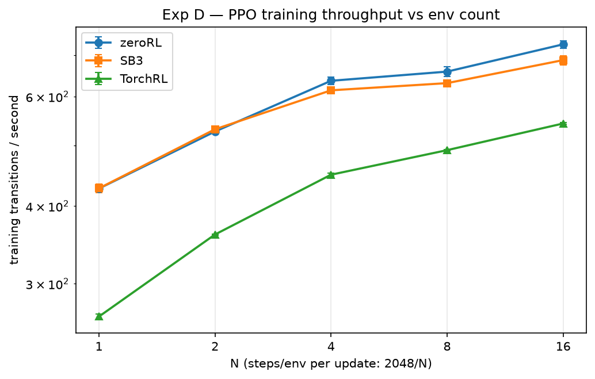
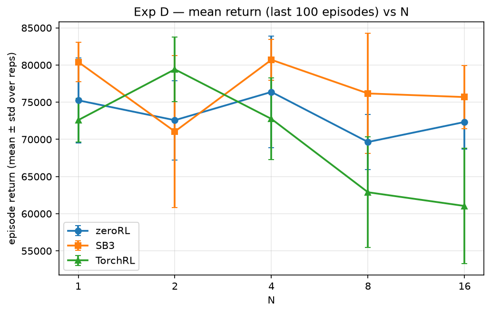

# Scalability benchmark report

Generated: 2026-11-09T22:45:51.028926+00:00 · rows: 652 · figures in `figures/`

## Environment

| key | value |
| --- | --- |
| python | 3.13.14 |
| platform | Linux-6.8.12-tegra-aarch64-with-glibc2.39 |
| processor | aarch64 |
| device | cpu |
| hostname | gpu1 |
| torch | 2.13.0+cu130 |
| torch_num_threads | 14 |
| cuda_available | True |
| gymnasium | 1.3.0 |
| sb3 | 2.9.0 |
| torchrl | 0.14.1 |
| tensordict | 0.14.3 |
| git_sha | 7813ea3a3711cfbcf6592ef8af5bb05b04fb4dc4 |

## Methodology (summary)

- Frameworks: zeroRL (this repo, official `rollout_phase` / `BaseTrain.train()`), Stable-Baselines3, TorchRL — same shared-trunk policy/weights where policies apply (see `policy_reference.py`).
- Experiments A/B count individual env transitions with a warmup of 16,000 (excluded) + 100,000 measured transitions per run; Experiments C/D train PPO for exactly 262,144 transitions per run.
- Repetitions: 5 seeds per cell for A/B, 3 for C/D; every reported statistic aggregates **all** ok repetitions (mean ± std), never best-of.
- Metrics: `throughput = measured / measure_seconds`, `speedup(N) = t(baseline) / t(N)`, `environment_scaling_efficiency(N) = speedup(N) / N`, `worker_parallel_efficiency(W) = speedup(W) / (W / 1)`.
- Phase timing: `init` = env + policy construction + weight load (+ TorchRL collector/worker spawn); `warmup` (A/B only, excluded); `boundary` (A/B only) = warmup→measure phase reset / collector-worker restart, timed as `boundary_seconds`; `measure` = the official training/collection steady state. Full framework-specific details in `INSPECTION.md`.
- Device: CPU (`CUDA_VISIBLE_DEVICES=""`); protocol C/D hyperparameters in `ppo_protocols.py` (lr 3e-4 linear-decay, gamma .99, gae_lambda .95, clip .2, entropy .01, value .5, epochs 10, batch 64, grad-clip .5).

## Experiment A — environment scaling (collection) [humanoidstandupv5]

| framework | N | throughput (trans/s) | mean time (s) | speedup (paired) | env-scaling efficiency (paired) | pairs (n) |
| --- | --- | --- | --- | --- | --- | --- |
| zeroRL | 1 | 607.3 ± 9.7 | 164.70 | 1.00 | 1.00 | 5 |
| zeroRL | 2 | 812.2 ± 28.7 | 123.27 | 1.35 ± 0.01 | 0.68 ± 0.00 | 5 |
| zeroRL | 4 | 1,080.0 ± 29.8 | 92.66 | 1.79 ± 0.01 | 0.45 ± 0.00 | 5 |
| zeroRL | 8 | 1,142.4 ± 34.3 | 87.61 | 1.89 ± 0.01 | 0.24 ± 0.00 | 5 |
| zeroRL | 16 | 1,332.7 ± 29.9 | 75.07 | 2.20 ± 0.01 | 0.14 ± 0.00 | 5 |
| SB3 | 1 | 622.3 ± 11.0 | 160.73 | 1.00 | 1.00 | 5 |
| SB3 | 2 | 804.4 ± 37.0 | 124.57 | 1.33 ± 0.01 | 0.66 ± 0.01 | 5 |
| SB3 | 4 | 1,071.6 ± 33.9 | 93.41 | 1.75 ± 0.01 | 0.44 ± 0.00 | 5 |
| SB3 | 8 | 1,128.6 ± 41.5 | 88.72 | 1.84 ± 0.01 | 0.23 ± 0.00 | 5 |
| SB3 | 16 | 1,314.7 ± 34.3 | 76.11 | 2.12 ± 0.01 | 0.13 ± 0.00 | 5 |
| TorchRL | 1 | 373.7 ± 14.5 | 267.99 | 1.00 | 1.00 | 5 |
| TorchRL | 2 | 597.6 ± 20.7 | 167.52 | 1.60 ± 0.01 | 0.80 ± 0.00 | 5 |
| TorchRL | 4 | 872.2 ± 23.6 | 114.73 | 2.31 ± 0.01 | 0.58 ± 0.00 | 5 |
| TorchRL | 8 | 1,005.5 ± 34.1 | 99.57 | 2.65 ± 0.02 | 0.33 ± 0.00 | 5 |
| TorchRL | 16 | 1,228.5 ± 28.4 | 81.44 | 3.21 ± 0.02 | 0.20 ± 0.00 | 5 |

## Experiment B — worker scaling (collection, N=8) [humanoidstandupv5]

| framework | W | throughput (trans/s) | mean time (s) | speedup (paired) | worker parallel efficiency (paired) | pairs (n) |
| --- | --- | --- | --- | --- | --- | --- |
| zeroRL | 1 | 1,159.2 ± 6.4 | 86.27 | 1.00 | 1.00 | 5 |
| SB3 | 1 | 1,168.4 ± 3.2 | 85.59 | 1.00 | 1.00 | 5 |
| SB3 | 8 | 2,297.0 ± 73.4 | 43.58 | 2.03 ± 0.03 | 0.25 ± 0.00 | 5 |
| TorchRL | 1 | 1,028.8 ± 4.1 | 97.20 | 1.00 | 1.00 | 5 |
| TorchRL | 2 | 2,103.9 ± 28.4 | 47.54 | 2.06 ± 0.04 | 1.03 ± 0.02 | 5 |
| TorchRL | 4 | 3,040.5 ± 31.7 | 32.89 | 2.98 ± 0.04 | 0.74 ± 0.01 | 5 |
| TorchRL | 8 | 3,984.8 ± 21.5 | 25.10 | 3.89 ± 0.01 | 0.49 ± 0.00 | 5 |

**Unsupported (recorded, not run)**:

- zeroRL W=2: zeroRL has no multi-process environment path (vectorize_env -> SyncVectorEnv only); W>=2 unsupported
- zeroRL W=2: zeroRL has no multi-process environment path (vectorize_env -> SyncVectorEnv only); W>=2 unsupported
- zeroRL W=2: zeroRL has no multi-process environment path (vectorize_env -> SyncVectorEnv only); W>=2 unsupported
- zeroRL W=2: zeroRL has no multi-process environment path (vectorize_env -> SyncVectorEnv only); W>=2 unsupported
- zeroRL W=2: zeroRL has no multi-process environment path (vectorize_env -> SyncVectorEnv only); W>=2 unsupported
- zeroRL W=4: zeroRL has no multi-process environment path (vectorize_env -> SyncVectorEnv only); W>=2 unsupported
- zeroRL W=4: zeroRL has no multi-process environment path (vectorize_env -> SyncVectorEnv only); W>=2 unsupported
- zeroRL W=4: zeroRL has no multi-process environment path (vectorize_env -> SyncVectorEnv only); W>=2 unsupported
- zeroRL W=4: zeroRL has no multi-process environment path (vectorize_env -> SyncVectorEnv only); W>=2 unsupported
- zeroRL W=4: zeroRL has no multi-process environment path (vectorize_env -> SyncVectorEnv only); W>=2 unsupported
- zeroRL W=8: zeroRL has no multi-process environment path (vectorize_env -> SyncVectorEnv only); W>=2 unsupported
- zeroRL W=8: zeroRL has no multi-process environment path (vectorize_env -> SyncVectorEnv only); W>=2 unsupported
- zeroRL W=8: zeroRL has no multi-process environment path (vectorize_env -> SyncVectorEnv only); W>=2 unsupported
- zeroRL W=8: zeroRL has no multi-process environment path (vectorize_env -> SyncVectorEnv only); W>=2 unsupported
- zeroRL W=8: zeroRL has no multi-process environment path (vectorize_env -> SyncVectorEnv only); W>=2 unsupported
- SB3 W=2: SB3 SubprocVecEnv runs exactly one process per env, so only W=1 (DummyVecEnv) and W=8 (SubprocVecEnv) exist; W=2 unsupported
- SB3 W=2: SB3 SubprocVecEnv runs exactly one process per env, so only W=1 (DummyVecEnv) and W=8 (SubprocVecEnv) exist; W=2 unsupported
- SB3 W=2: SB3 SubprocVecEnv runs exactly one process per env, so only W=1 (DummyVecEnv) and W=8 (SubprocVecEnv) exist; W=2 unsupported
- SB3 W=2: SB3 SubprocVecEnv runs exactly one process per env, so only W=1 (DummyVecEnv) and W=8 (SubprocVecEnv) exist; W=2 unsupported
- SB3 W=2: SB3 SubprocVecEnv runs exactly one process per env, so only W=1 (DummyVecEnv) and W=8 (SubprocVecEnv) exist; W=2 unsupported
- SB3 W=4: SB3 SubprocVecEnv runs exactly one process per env, so only W=1 (DummyVecEnv) and W=8 (SubprocVecEnv) exist; W=4 unsupported
- SB3 W=4: SB3 SubprocVecEnv runs exactly one process per env, so only W=1 (DummyVecEnv) and W=8 (SubprocVecEnv) exist; W=4 unsupported
- SB3 W=4: SB3 SubprocVecEnv runs exactly one process per env, so only W=1 (DummyVecEnv) and W=8 (SubprocVecEnv) exist; W=4 unsupported
- SB3 W=4: SB3 SubprocVecEnv runs exactly one process per env, so only W=1 (DummyVecEnv) and W=8 (SubprocVecEnv) exist; W=4 unsupported
- SB3 W=4: SB3 SubprocVecEnv runs exactly one process per env, so only W=1 (DummyVecEnv) and W=8 (SubprocVecEnv) exist; W=4 unsupported
- zeroRL W=2: zeroRL has no multi-process environment path (vectorize_env -> SyncVectorEnv only); W>=2 unsupported
- zeroRL W=2: zeroRL has no multi-process environment path (vectorize_env -> SyncVectorEnv only); W>=2 unsupported
- zeroRL W=2: zeroRL has no multi-process environment path (vectorize_env -> SyncVectorEnv only); W>=2 unsupported
- zeroRL W=2: zeroRL has no multi-process environment path (vectorize_env -> SyncVectorEnv only); W>=2 unsupported
- zeroRL W=2: zeroRL has no multi-process environment path (vectorize_env -> SyncVectorEnv only); W>=2 unsupported
- zeroRL W=4: zeroRL has no multi-process environment path (vectorize_env -> SyncVectorEnv only); W>=2 unsupported
- zeroRL W=4: zeroRL has no multi-process environment path (vectorize_env -> SyncVectorEnv only); W>=2 unsupported
- zeroRL W=4: zeroRL has no multi-process environment path (vectorize_env -> SyncVectorEnv only); W>=2 unsupported
- zeroRL W=4: zeroRL has no multi-process environment path (vectorize_env -> SyncVectorEnv only); W>=2 unsupported
- zeroRL W=4: zeroRL has no multi-process environment path (vectorize_env -> SyncVectorEnv only); W>=2 unsupported
- zeroRL W=8: zeroRL has no multi-process environment path (vectorize_env -> SyncVectorEnv only); W>=2 unsupported
- zeroRL W=8: zeroRL has no multi-process environment path (vectorize_env -> SyncVectorEnv only); W>=2 unsupported
- zeroRL W=8: zeroRL has no multi-process environment path (vectorize_env -> SyncVectorEnv only); W>=2 unsupported
- zeroRL W=8: zeroRL has no multi-process environment path (vectorize_env -> SyncVectorEnv only); W>=2 unsupported
- zeroRL W=8: zeroRL has no multi-process environment path (vectorize_env -> SyncVectorEnv only); W>=2 unsupported
- SB3 W=2: SB3 SubprocVecEnv runs exactly one process per env, so only W=1 (DummyVecEnv) and W=8 (SubprocVecEnv) exist; W=2 unsupported
- SB3 W=2: SB3 SubprocVecEnv runs exactly one process per env, so only W=1 (DummyVecEnv) and W=8 (SubprocVecEnv) exist; W=2 unsupported
- SB3 W=2: SB3 SubprocVecEnv runs exactly one process per env, so only W=1 (DummyVecEnv) and W=8 (SubprocVecEnv) exist; W=2 unsupported
- SB3 W=2: SB3 SubprocVecEnv runs exactly one process per env, so only W=1 (DummyVecEnv) and W=8 (SubprocVecEnv) exist; W=2 unsupported
- SB3 W=2: SB3 SubprocVecEnv runs exactly one process per env, so only W=1 (DummyVecEnv) and W=8 (SubprocVecEnv) exist; W=2 unsupported
- SB3 W=4: SB3 SubprocVecEnv runs exactly one process per env, so only W=1 (DummyVecEnv) and W=8 (SubprocVecEnv) exist; W=4 unsupported
- SB3 W=4: SB3 SubprocVecEnv runs exactly one process per env, so only W=1 (DummyVecEnv) and W=8 (SubprocVecEnv) exist; W=4 unsupported
- SB3 W=4: SB3 SubprocVecEnv runs exactly one process per env, so only W=1 (DummyVecEnv) and W=8 (SubprocVecEnv) exist; W=4 unsupported
- SB3 W=4: SB3 SubprocVecEnv runs exactly one process per env, so only W=1 (DummyVecEnv) and W=8 (SubprocVecEnv) exist; W=4 unsupported
- SB3 W=4: SB3 SubprocVecEnv runs exactly one process per env, so only W=1 (DummyVecEnv) and W=8 (SubprocVecEnv) exist; W=4 unsupported
- zeroRL W=2: zeroRL has no multi-process environment path (vectorize_env -> SyncVectorEnv only); W>=2 unsupported
- zeroRL W=2: zeroRL has no multi-process environment path (vectorize_env -> SyncVectorEnv only); W>=2 unsupported
- zeroRL W=2: zeroRL has no multi-process environment path (vectorize_env -> SyncVectorEnv only); W>=2 unsupported
- zeroRL W=2: zeroRL has no multi-process environment path (vectorize_env -> SyncVectorEnv only); W>=2 unsupported
- zeroRL W=2: zeroRL has no multi-process environment path (vectorize_env -> SyncVectorEnv only); W>=2 unsupported
- zeroRL W=4: zeroRL has no multi-process environment path (vectorize_env -> SyncVectorEnv only); W>=2 unsupported
- zeroRL W=4: zeroRL has no multi-process environment path (vectorize_env -> SyncVectorEnv only); W>=2 unsupported
- zeroRL W=4: zeroRL has no multi-process environment path (vectorize_env -> SyncVectorEnv only); W>=2 unsupported
- zeroRL W=4: zeroRL has no multi-process environment path (vectorize_env -> SyncVectorEnv only); W>=2 unsupported
- zeroRL W=4: zeroRL has no multi-process environment path (vectorize_env -> SyncVectorEnv only); W>=2 unsupported
- zeroRL W=8: zeroRL has no multi-process environment path (vectorize_env -> SyncVectorEnv only); W>=2 unsupported
- zeroRL W=8: zeroRL has no multi-process environment path (vectorize_env -> SyncVectorEnv only); W>=2 unsupported
- zeroRL W=8: zeroRL has no multi-process environment path (vectorize_env -> SyncVectorEnv only); W>=2 unsupported
- zeroRL W=8: zeroRL has no multi-process environment path (vectorize_env -> SyncVectorEnv only); W>=2 unsupported
- zeroRL W=8: zeroRL has no multi-process environment path (vectorize_env -> SyncVectorEnv only); W>=2 unsupported
- SB3 W=2: SB3 SubprocVecEnv runs exactly one process per env, so only W=1 (DummyVecEnv) and W=8 (SubprocVecEnv) exist; W=2 unsupported
- SB3 W=2: SB3 SubprocVecEnv runs exactly one process per env, so only W=1 (DummyVecEnv) and W=8 (SubprocVecEnv) exist; W=2 unsupported
- SB3 W=2: SB3 SubprocVecEnv runs exactly one process per env, so only W=1 (DummyVecEnv) and W=8 (SubprocVecEnv) exist; W=2 unsupported
- SB3 W=2: SB3 SubprocVecEnv runs exactly one process per env, so only W=1 (DummyVecEnv) and W=8 (SubprocVecEnv) exist; W=2 unsupported
- SB3 W=2: SB3 SubprocVecEnv runs exactly one process per env, so only W=1 (DummyVecEnv) and W=8 (SubprocVecEnv) exist; W=2 unsupported
- SB3 W=4: SB3 SubprocVecEnv runs exactly one process per env, so only W=1 (DummyVecEnv) and W=8 (SubprocVecEnv) exist; W=4 unsupported
- SB3 W=4: SB3 SubprocVecEnv runs exactly one process per env, so only W=1 (DummyVecEnv) and W=8 (SubprocVecEnv) exist; W=4 unsupported
- SB3 W=4: SB3 SubprocVecEnv runs exactly one process per env, so only W=1 (DummyVecEnv) and W=8 (SubprocVecEnv) exist; W=4 unsupported
- SB3 W=4: SB3 SubprocVecEnv runs exactly one process per env, so only W=1 (DummyVecEnv) and W=8 (SubprocVecEnv) exist; W=4 unsupported
- SB3 W=4: SB3 SubprocVecEnv runs exactly one process per env, so only W=1 (DummyVecEnv) and W=8 (SubprocVecEnv) exist; W=4 unsupported

## Experiment C — PPO training protocol (fixed 2048 steps/env per rollout) [humanoidstandupv5]

| framework | N | updates | throughput (trans/s) | mean time (s) | mean return (last 100) | reps |
| --- | --- | --- | --- | --- | --- | --- |
| zeroRL | 1 | 128 | 427.0 ± 2.8 | 614.0 | 75,253.6 ± 4,946.0 | 9 |
| zeroRL | 2 | 64 | 533.8 ± 6.0 | 491.1 | 75,079.7 ± 3,768.4 | 9 |
| zeroRL | 4 | 32 | 650.0 ± 4.7 | 403.3 | 64,966.9 ± 4,401.4 | 9 |
| zeroRL | 8 | 16 | 684.4 ± 7.6 | 383.0 | 57,229.6 ± 1,848.8 | 9 |
| zeroRL | 16 | 8 | 760.5 ± 5.6 | 344.7 | 47,649.0 ± 774.1 | 9 |
| SB3 | 1 | 128 | 418.5 ± 7.6 | 626.6 | 80,410.9 ± 2,287.9 | 9 |
| SB3 | 2 | 64 | 526.2 ± 5.1 | 498.2 | 73,775.3 ± 2,775.7 | 9 |
| SB3 | 4 | 32 | 627.0 ± 4.9 | 418.1 | 70,151.9 ± 1,656.8 | 9 |
| SB3 | 8 | 16 | 654.8 ± 5.5 | 400.4 | 62,676.0 ± 2,290.6 | 9 |
| SB3 | 16 | 8 | 719.8 ± 4.0 | 364.2 | 50,308.9 ± 1,951.7 | 9 |
| TorchRL | 1 | 128 | 264.0 ± 2.6 | 992.9 | 72,593.4 ± 2,541.5 | 9 |
| TorchRL | 2 | 64 | 364.2 ± 3.6 | 719.9 | 73,504.3 ± 2,985.9 | 9 |
| TorchRL | 4 | 32 | 459.4 ± 3.9 | 570.7 | 67,696.1 ± 2,424.3 | 9 |
| TorchRL | 8 | 16 | 501.9 ± 4.9 | 522.4 | 64,621.7 ± 798.2 | 9 |
| TorchRL | 16 | 8 | 558.4 ± 4.6 | 469.5 | 48,612.7 ± 1,507.8 | 9 |

## Experiment D — PPO training protocol (fixed global rollout of 2048) [humanoidstandupv5]

| framework | N | updates | throughput (trans/s) | mean time (s) | mean return (last 100) | reps |
| --- | --- | --- | --- | --- | --- | --- |
| zeroRL | 1 | 128 | 426.8 ± 0.4 | 614.3 | 75,253.6 ± 5,711.2 | 3 |
| zeroRL | 2 | 128 | 527.1 ± 4.3 | 497.3 | 72,579.6 ± 5,331.1 | 3 |
| zeroRL | 4 | 128 | 636.1 ± 8.4 | 412.2 | 76,379.8 ± 7,525.0 | 3 |
| zeroRL | 8 | 128 | 658.1 ± 11.9 | 398.4 | 69,645.4 ± 3,713.6 | 3 |
| zeroRL | 16 | 128 | 728.0 ± 9.9 | 360.1 | 72,338.4 ± 3,679.5 | 3 |
| SB3 | 1 | 128 | 427.1 ± 6.7 | 613.9 | 80,410.9 ± 2,641.8 | 3 |
| SB3 | 2 | 128 | 531.5 ± 4.8 | 493.2 | 71,057.8 ± 10,239.6 | 3 |
| SB3 | 4 | 128 | 614.0 ± 1.3 | 426.9 | 80,706.0 ± 2,756.5 | 3 |
| SB3 | 8 | 128 | 630.6 ± 6.2 | 415.8 | 76,177.3 ± 8,083.8 | 3 |
| SB3 | 16 | 128 | 686.7 ± 11.7 | 381.8 | 75,692.0 ± 4,241.8 | 3 |
| TorchRL | 1 | 128 | 265.6 ± 2.6 | 986.9 | 72,593.4 ± 2,934.7 | 3 |
| TorchRL | 2 | 128 | 360.0 ± 0.7 | 728.3 | 79,422.3 ± 4,355.2 | 3 |
| TorchRL | 4 | 128 | 449.2 ± 2.5 | 583.6 | 72,755.0 ± 5,498.7 | 3 |
| TorchRL | 8 | 128 | 492.0 ± 1.2 | 532.9 | 62,886.5 ± 7,454.8 | 3 |
| TorchRL | 16 | 128 | 543.0 ± 1.6 | 482.7 | 61,041.8 ± 7,763.8 | 3 |

## Findings (computed from the data)

- Exp A collection, N=1: fastest = **SB3** (622 trans/s); also zeroRL 607, TorchRL 374.
- Exp A collection, N=2: fastest = **zeroRL** (812 trans/s); also SB3 804, TorchRL 598.
- Exp A collection, N=4: fastest = **zeroRL** (1,080 trans/s); also SB3 1,072, TorchRL 872.
- Exp A collection, N=8: fastest = **zeroRL** (1,142 trans/s); also SB3 1,129, TorchRL 1,005.
- Exp A collection, N=16: fastest = **zeroRL** (1,333 trans/s); also SB3 1,315, TorchRL 1,229.
- Exp B collection, W=1 (N=8): fastest = **SB3** (1,168 trans/s); also zeroRL 1,159, TorchRL 1,029.
- Exp B collection, W=2 (N=8): fastest = **TorchRL** (2,104 trans/s).
- Exp B collection, W=4 (N=8): fastest = **TorchRL** (3,040 trans/s).
- Exp B collection, W=8 (N=8): fastest = **TorchRL** (3,985 trans/s); also SB3 2,297.
- Exp C PPO, N=1: fastest = **zeroRL** (427 trans/s); also SB3 418, TorchRL 264.
- Exp C PPO, N=2: fastest = **zeroRL** (534 trans/s); also SB3 526, TorchRL 364.
- Exp C PPO, N=4: fastest = **zeroRL** (650 trans/s); also SB3 627, TorchRL 459.
- Exp C PPO, N=8: fastest = **zeroRL** (684 trans/s); also SB3 655, TorchRL 502.
- Exp C PPO, N=16: fastest = **zeroRL** (761 trans/s); also SB3 720, TorchRL 558.
- Exp D PPO, N=1: fastest = **SB3** (427 trans/s); also zeroRL 427, TorchRL 266.
- Exp D PPO, N=2: fastest = **SB3** (532 trans/s); also zeroRL 527, TorchRL 360.
- Exp D PPO, N=4: fastest = **zeroRL** (636 trans/s); also SB3 614, TorchRL 449.
- Exp D PPO, N=8: fastest = **zeroRL** (658 trans/s); also SB3 631, TorchRL 492.
- Exp D PPO, N=16: fastest = **zeroRL** (728 trans/s); also SB3 687, TorchRL 543.
- zeroRL env-scaling efficiency at N=16: 0.14 ± 0.00 (speedup 2.20 ± 0.01, n=5 paired reps, 16x envs).
- SB3 env-scaling efficiency at N=16: 0.13 ± 0.00 (speedup 2.12 ± 0.01, n=5 paired reps, 16x envs).
- TorchRL env-scaling efficiency at N=16: 0.20 ± 0.00 (speedup 3.21 ± 0.02, n=5 paired reps, 16x envs).
- zeroRL worker parallel efficiency at W=1: 1.00 (speedup 1.00, n=5 paired reps, 1x workers).
- SB3 worker parallel efficiency at W=8: 0.25 ± 0.00 (speedup 2.03 ± 0.03, n=5 paired reps, 8x workers).
- TorchRL worker parallel efficiency at W=8: 0.49 ± 0.00 (speedup 3.89 ± 0.01, n=5 paired reps, 8x workers).
- zeroRL N=1: training throughput C=427 vs D=427 trans/s (≈ equal).
- SB3 N=1: training throughput C=418 vs D=427 trans/s (D faster).
- TorchRL N=1: training throughput C=264 vs D=266 trans/s (≈ equal).

## Data integrity

| experiment | ok | failed | unsupported |
| --- | --- | --- | --- |
| A | 292 | 0 | 0 |
| B | 105 | 0 | 75 |
| C | 135 | 0 | 0 |
| D | 45 | 0 | 0 |

All ok rows recorded an exact transition budget.

Total rows: 652.

## Appendix — protocol C/D configuration (from a result row)

| key | value |
| --- | --- |
| device | cpu |
| env_id | HumanoidStandup-v5 |
| rollout_steps_per_env | 2048 |
| rollout_global | 2048 |
| updates | 128 |
| total | 262144 |
| lr | 0.0003 |
| gamma | 0.99 |
| gae_lambda | 0.95 |
| clip_eps | 0.2 |
| ent_coef | 0.01 |
| vf_coef | 0.5 |
| epochs | 10 |
| batch_size | 64 |
| grad_clip | 0.5 |
| lr_start | 0.0003 |
| lr_end | 0.0 |
| optimizer | {'type': 'Adam', 'eps': 1e-05, 'schedule': 'linear_decay_to_zero'} |
| net_arch | [64, 64] |
| reference_seed | 4242 |

---
See `README.md` (reproduction), `INSPECTION.md` (framework findings), `results/*.jsonl` (raw data).
