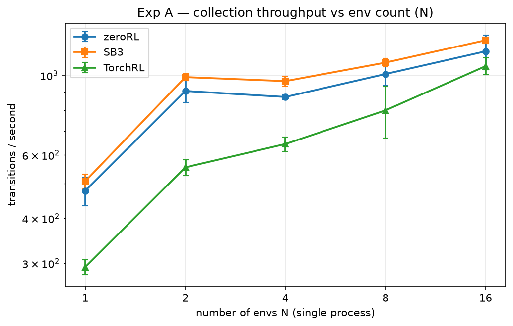
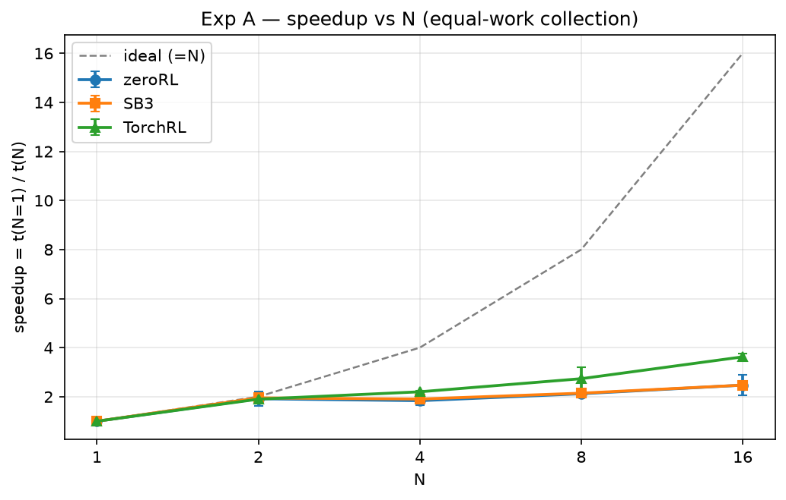
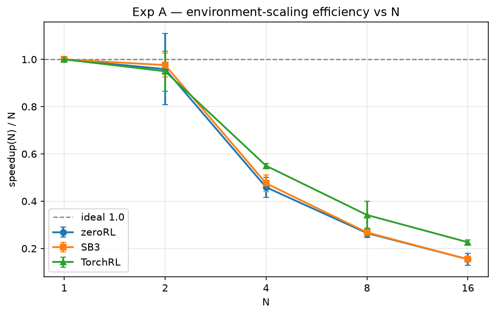
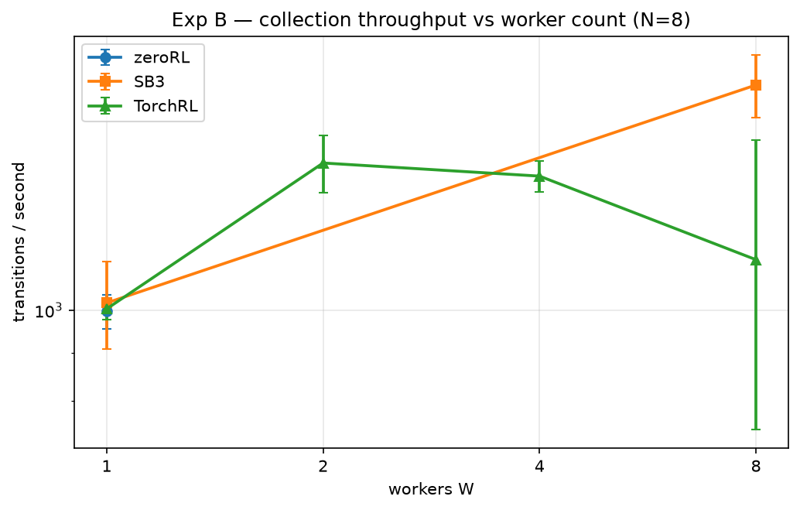
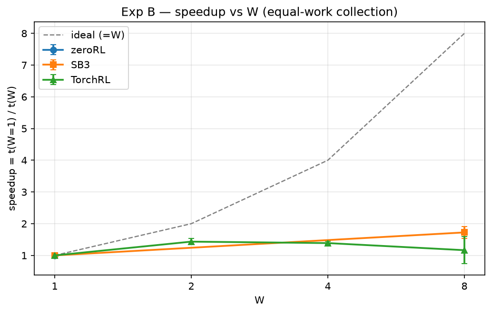
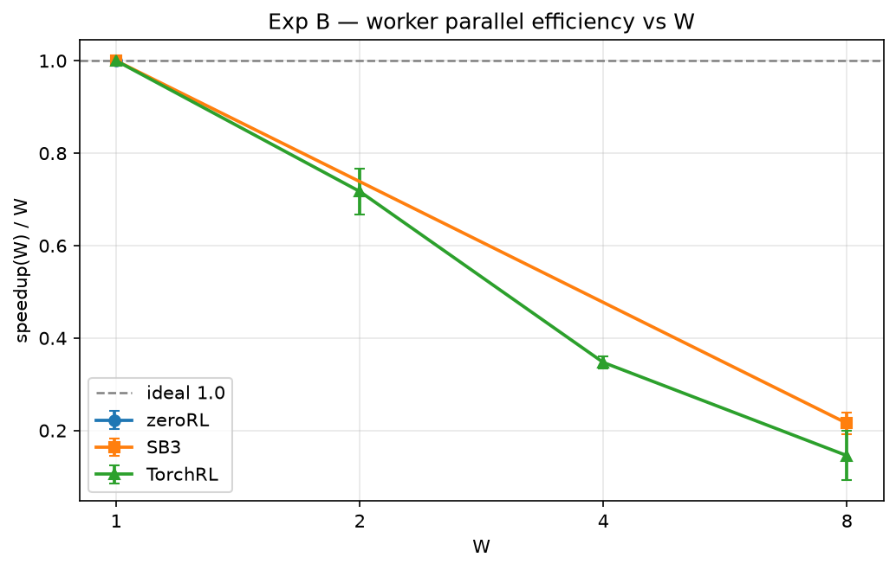
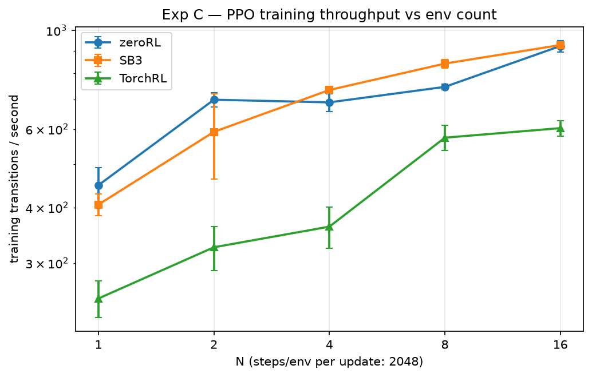
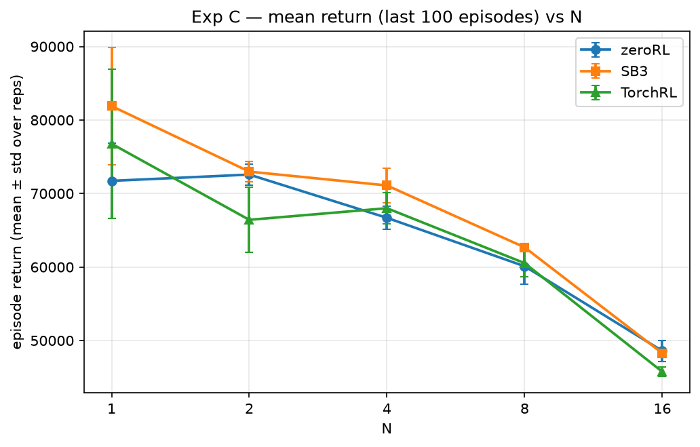
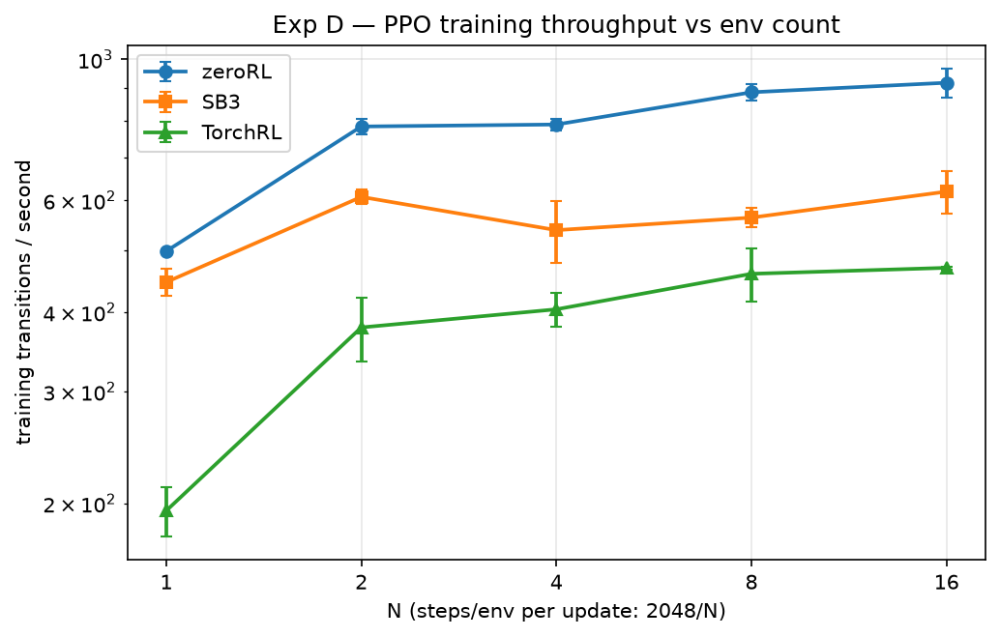
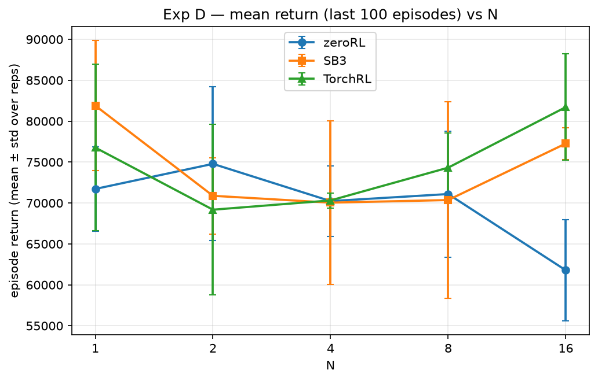

# Scalability benchmark report

Generated: 2026-11-08T23:35:46.205679+00:00 · rows: 222 · figures in `figures/`

## Environment

| key | value |
| --- | --- |
| python | 3.11.14 |
| platform | Linux-5.15.167.4-microsoft-standard-WSL2-x86_64-with-glibc2.39 |
| processor | x86_64 |
| device | cpu |
| hostname | darrius |
| torch | 2.13.0+cu130 |
| torch_num_threads | 6 |
| cuda_available | False |
| gymnasium | 1.3.0 |
| sb3 | 2.9.2 |
| torchrl | 0.14.1 |
| tensordict | 0.14.3 |
| git_sha | 7c35dda65425dbe958b9540bc2ef4c605ce23994 |

## Methodology (summary)

- Frameworks: zeroRL (this repo, official `rollout_phase` / `BaseTrain.train()`), Stable-Baselines3, TorchRL — same shared-trunk policy/weights where policies apply (see `policy_reference.py`).
- Experiments A/B count individual env transitions with a warmup of 16,000 (excluded) + 100,000 measured transitions per run; Experiments C/D train PPO for exactly 262,144 transitions per run.
- Repetitions: 5 seeds per cell for A/B, 3 for C/D; every reported statistic aggregates **all** ok repetitions (mean ± std), never best-of.
- Metrics: `throughput = measured / measure_seconds`, `speedup(N) = t(baseline) / t(N)`, `environment_scaling_efficiency(N) = speedup(N) / N`, `worker_parallel_efficiency(W) = speedup(W) / (W / 1)`.
- Phase timing: `init` = env + policy construction + weight load (+ TorchRL collector/worker spawn); `warmup` (A/B only, excluded); `boundary` (A/B only) = warmup→measure phase reset / collector-worker restart, timed as `boundary_seconds`; `measure` = the official training/collection steady state. Full framework-specific details in `INSPECTION.md`.
- Device: CPU (`CUDA_VISIBLE_DEVICES=""`); protocol C/D hyperparameters in `ppo_protocols.py` (lr 3e-4 linear-decay, gamma .99, gae_lambda .95, clip .2, entropy .01, value .5, epochs 10, batch 64, grad-clip .5).

## Experiment A — environment scaling (collection) [humanoidstandupv4]

| framework | N | throughput (trans/s) | mean time (s) | speedup (paired) | env-scaling efficiency (paired) | pairs (n) |
| --- | --- | --- | --- | --- | --- | --- |
| zeroRL | 1 | 477.3 ± 44.0 | 210.96 | 1.00 | 1.00 | 5 |
| zeroRL | 2 | 904.8 ± 64.3 | 110.98 | 1.92 ± 0.30 | 0.96 ± 0.15 | 5 |
| zeroRL | 4 | 870.8 ± 14.3 | 114.86 | 1.84 ± 0.17 | 0.46 ± 0.04 | 5 |
| zeroRL | 8 | 1,008.9 ± 72.5 | 99.57 | 2.12 ± 0.15 | 0.27 ± 0.02 | 5 |
| zeroRL | 16 | 1,166.9 ± 128.9 | 86.65 | 2.47 ± 0.41 | 0.15 ± 0.03 | 5 |
| SB3 | 1 | 507.6 ± 22.7 | 197.33 | 1.00 | 1.00 | 5 |
| SB3 | 2 | 988.9 ± 22.2 | 101.16 | 1.95 ± 0.10 | 0.98 ± 0.05 | 5 |
| SB3 | 4 | 963.9 ± 30.1 | 103.83 | 1.90 ± 0.14 | 0.48 ± 0.04 | 5 |
| SB3 | 8 | 1,085.5 ± 29.9 | 92.18 | 2.14 ± 0.14 | 0.27 ± 0.02 | 5 |
| SB3 | 16 | 1,252.6 ± 24.7 | 79.86 | 2.47 ± 0.11 | 0.15 ± 0.01 | 5 |
| TorchRL | 1 | 292.8 ± 14.0 | 342.12 | 1.00 | 1.00 | 5 |
| TorchRL | 2 | 554.5 ± 27.9 | 180.70 | 1.90 ± 0.17 | 0.95 ± 0.08 | 5 |
| TorchRL | 4 | 644.1 ± 30.4 | 155.54 | 2.20 ± 0.04 | 0.55 ± 0.01 | 5 |
| TorchRL | 8 | 799.3 ± 130.6 | 128.01 | 2.73 ± 0.46 | 0.34 ± 0.06 | 5 |
| TorchRL | 16 | 1,061.0 ± 57.9 | 94.49 | 3.62 ± 0.14 | 0.23 ± 0.01 | 5 |

## Experiment B — worker scaling (collection, N=8) [humanoidstandupv4]

| framework | W | throughput (trans/s) | mean time (s) | speedup (paired) | worker parallel efficiency (paired) | pairs (n) |
| --- | --- | --- | --- | --- | --- | --- |
| zeroRL | 1 | 997.3 ± 41.8 | 100.41 | 1.00 | 1.00 | 5 |
| SB3 | 1 | 1,018.2 ± 110.1 | 99.15 | 1.00 | 1.00 | 5 |
| SB3 | 8 | 1,744.3 ± 135.6 | 57.62 | 1.72 ± 0.18 | 0.22 ± 0.02 | 5 |
| TorchRL | 1 | 1,003.3 ± 27.2 | 99.73 | 1.00 | 1.00 | 5 |
| TorchRL | 2 | 1,438.6 ± 101.8 | 69.79 | 1.43 ± 0.10 | 0.72 ± 0.05 | 5 |
| TorchRL | 4 | 1,392.7 ± 52.3 | 71.88 | 1.39 ± 0.05 | 0.35 ± 0.01 | 5 |
| TorchRL | 8 | 1,133.0 ± 388.4 | 93.77 | 1.16 ± 0.43 | 0.15 ± 0.05 | 2 |

**Unsupported (recorded, not run)**:

- zeroRL W=2: zeroRL has no multi-process environment path (vectorize_env -> SyncVectorEnv only); W>=2 unsupported
- zeroRL W=2: zeroRL has no multi-process environment path (vectorize_env -> SyncVectorEnv only); W>=2 unsupported
- zeroRL W=2: zeroRL has no multi-process environment path (vectorize_env -> SyncVectorEnv only); W>=2 unsupported
- zeroRL W=2: zeroRL has no multi-process environment path (vectorize_env -> SyncVectorEnv only); W>=2 unsupported
- zeroRL W=2: zeroRL has no multi-process environment path (vectorize_env -> SyncVectorEnv only); W>=2 unsupported
- zeroRL W=4: zeroRL has no multi-process environment path (vectorize_env -> SyncVectorEnv only); W>=2 unsupported
- zeroRL W=4: zeroRL has no multi-process environment path (vectorize_env -> SyncVectorEnv only); W>=2 unsupported
- zeroRL W=4: zeroRL has no multi-process environment path (vectorize_env -> SyncVectorEnv only); W>=2 unsupported
- zeroRL W=4: zeroRL has no multi-process environment path (vectorize_env -> SyncVectorEnv only); W>=2 unsupported
- zeroRL W=4: zeroRL has no multi-process environment path (vectorize_env -> SyncVectorEnv only); W>=2 unsupported
- zeroRL W=8: zeroRL has no multi-process environment path (vectorize_env -> SyncVectorEnv only); W>=2 unsupported
- zeroRL W=8: zeroRL has no multi-process environment path (vectorize_env -> SyncVectorEnv only); W>=2 unsupported
- zeroRL W=8: zeroRL has no multi-process environment path (vectorize_env -> SyncVectorEnv only); W>=2 unsupported
- zeroRL W=8: zeroRL has no multi-process environment path (vectorize_env -> SyncVectorEnv only); W>=2 unsupported
- zeroRL W=8: zeroRL has no multi-process environment path (vectorize_env -> SyncVectorEnv only); W>=2 unsupported
- SB3 W=2: SB3 SubprocVecEnv runs exactly one process per env, so only W=1 (DummyVecEnv) and W=8 (SubprocVecEnv) exist; W=2 unsupported
- SB3 W=2: SB3 SubprocVecEnv runs exactly one process per env, so only W=1 (DummyVecEnv) and W=8 (SubprocVecEnv) exist; W=2 unsupported
- SB3 W=2: SB3 SubprocVecEnv runs exactly one process per env, so only W=1 (DummyVecEnv) and W=8 (SubprocVecEnv) exist; W=2 unsupported
- SB3 W=2: SB3 SubprocVecEnv runs exactly one process per env, so only W=1 (DummyVecEnv) and W=8 (SubprocVecEnv) exist; W=2 unsupported
- SB3 W=2: SB3 SubprocVecEnv runs exactly one process per env, so only W=1 (DummyVecEnv) and W=8 (SubprocVecEnv) exist; W=2 unsupported
- SB3 W=4: SB3 SubprocVecEnv runs exactly one process per env, so only W=1 (DummyVecEnv) and W=8 (SubprocVecEnv) exist; W=4 unsupported
- SB3 W=4: SB3 SubprocVecEnv runs exactly one process per env, so only W=1 (DummyVecEnv) and W=8 (SubprocVecEnv) exist; W=4 unsupported
- SB3 W=4: SB3 SubprocVecEnv runs exactly one process per env, so only W=1 (DummyVecEnv) and W=8 (SubprocVecEnv) exist; W=4 unsupported
- SB3 W=4: SB3 SubprocVecEnv runs exactly one process per env, so only W=1 (DummyVecEnv) and W=8 (SubprocVecEnv) exist; W=4 unsupported
- SB3 W=4: SB3 SubprocVecEnv runs exactly one process per env, so only W=1 (DummyVecEnv) and W=8 (SubprocVecEnv) exist; W=4 unsupported

## Experiment C — PPO training protocol (fixed 2048 steps/env per rollout) [humanoidstandupv4]

| framework | N | updates | throughput (trans/s) | mean time (s) | mean return (last 100) | reps |
| --- | --- | --- | --- | --- | --- | --- |
| zeroRL | 1 | 128 | 448.7 ± 43.4 | 588.1 | 71,721.3 ± 5,141.0 | 3 |
| zeroRL | 2 | 64 | 698.4 ± 25.1 | 375.7 | 72,577.5 ± 1,410.7 | 3 |
| zeroRL | 4 | 32 | 688.9 ± 31.5 | 381.0 | 66,694.1 ± 1,563.2 | 3 |
| zeroRL | 8 | 16 | 746.4 ± 11.6 | 351.3 | 60,103.3 ± 2,441.5 | 3 |
| zeroRL | 16 | 8 | 922.0 ± 27.1 | 284.5 | 48,586.5 ± 1,411.6 | 3 |
| SB3 | 1 | 128 | 405.9 ± 22.7 | 647.2 | 81,895.9 ± 7,947.9 | 3 |
| SB3 | 2 | 64 | 591.4 ± 128.3 | 457.9 | 72,980.0 ± 1,357.9 | 3 |
| SB3 | 4 | 32 | 734.5 ± 8.0 | 356.9 | 71,097.0 ± 2,373.1 | 3 |
| SB3 | 8 | 16 | 842.0 ± 19.0 | 311.4 | 62,677.9 ± 460.1 | 3 |
| SB3 | 16 | 8 | 926.9 ± 13.5 | 282.9 | 48,274.2 ± 537.6 | 3 |
| TorchRL | 1 | 128 | 249.7 ± 23.4 | 1,056.4 | 76,768.6 ± 10,162.6 | 3 |
| TorchRL | 2 | 64 | 325.5 ± 37.0 | 812.9 | 66,420.2 ± 4,467.1 | 3 |
| TorchRL | 4 | 32 | 362.1 ± 38.1 | 729.0 | 67,998.8 ± 2,092.7 | 3 |
| TorchRL | 8 | 16 | 573.8 ± 37.5 | 458.2 | 60,530.6 ± 1,835.5 | 3 |
| TorchRL | 16 | 8 | 602.9 ± 24.4 | 435.3 | 45,756.4 ± 660.0 | 3 |

## Experiment D — PPO training protocol (fixed global rollout of 2048) [humanoidstandupv4]

| framework | N | updates | throughput (trans/s) | mean time (s) | mean return (last 100) | reps |
| --- | --- | --- | --- | --- | --- | --- |
| zeroRL | 1 | 128 | 498.9 ± 2.4 | 525.5 | 71,721.3 ± 5,141.0 | 3 |
| zeroRL | 2 | 128 | 783.9 ± 20.8 | 334.6 | 74,784.7 ± 9,395.8 | 3 |
| zeroRL | 4 | 128 | 789.6 ± 17.2 | 332.1 | 70,234.5 ± 4,309.0 | 3 |
| zeroRL | 8 | 128 | 887.4 ± 25.5 | 295.6 | 71,096.1 ± 7,690.8 | 3 |
| zeroRL | 16 | 128 | 918.6 ± 49.2 | 285.9 | 61,783.3 ± 6,195.8 | 3 |
| SB3 | 1 | 128 | 445.9 ± 22.0 | 588.8 | 81,895.9 ± 7,947.9 | 3 |
| SB3 | 2 | 128 | 607.3 ± 16.1 | 431.8 | 70,882.0 ± 4,671.3 | 3 |
| SB3 | 4 | 128 | 538.4 ± 60.9 | 491.0 | 70,046.3 ± 9,961.9 | 3 |
| SB3 | 8 | 128 | 563.4 ± 19.6 | 465.6 | 70,362.7 ± 11,992.5 | 3 |
| SB3 | 16 | 128 | 619.1 ± 47.6 | 425.1 | 77,269.5 ± 1,929.3 | 3 |
| TorchRL | 1 | 128 | 194.7 ± 17.4 | 1,353.5 | 76,768.6 ± 10,162.6 | 3 |
| TorchRL | 2 | 128 | 378.4 ± 43.5 | 698.7 | 69,183.7 ± 10,421.5 | 3 |
| TorchRL | 4 | 128 | 404.1 ± 24.4 | 650.4 | 70,316.6 ± 910.2 | 3 |
| TorchRL | 8 | 128 | 459.6 ± 44.1 | 573.7 | 74,321.1 ± 4,217.9 | 3 |
| TorchRL | 16 | 128 | 469.7 ± 2.5 | 558.2 | 81,716.5 ± 6,489.2 | 3 |

## Findings (computed from the data)

- Exp A collection, N=1: fastest = **SB3** (508 trans/s); also zeroRL 477, TorchRL 293.
- Exp A collection, N=2: fastest = **SB3** (989 trans/s); also zeroRL 905, TorchRL 555.
- Exp A collection, N=4: fastest = **SB3** (964 trans/s); also zeroRL 871, TorchRL 644.
- Exp A collection, N=8: fastest = **SB3** (1,086 trans/s); also zeroRL 1,009, TorchRL 799.
- Exp A collection, N=16: fastest = **SB3** (1,253 trans/s); also zeroRL 1,167, TorchRL 1,061.
- Exp B collection, W=1 (N=8): fastest = **SB3** (1,018 trans/s); also TorchRL 1,003, zeroRL 997.
- Exp B collection, W=2 (N=8): fastest = **TorchRL** (1,439 trans/s).
- Exp B collection, W=4 (N=8): fastest = **TorchRL** (1,393 trans/s).
- Exp B collection, W=8 (N=8): fastest = **SB3** (1,744 trans/s); also TorchRL 1,133.
- Exp C PPO, N=1: fastest = **zeroRL** (449 trans/s); also SB3 406, TorchRL 250.
- Exp C PPO, N=2: fastest = **zeroRL** (698 trans/s); also SB3 591, TorchRL 325.
- Exp C PPO, N=4: fastest = **SB3** (735 trans/s); also zeroRL 689, TorchRL 362.
- Exp C PPO, N=8: fastest = **SB3** (842 trans/s); also zeroRL 746, TorchRL 574.
- Exp C PPO, N=16: fastest = **SB3** (927 trans/s); also zeroRL 922, TorchRL 603.
- Exp D PPO, N=1: fastest = **zeroRL** (499 trans/s); also SB3 446, TorchRL 195.
- Exp D PPO, N=2: fastest = **zeroRL** (784 trans/s); also SB3 607, TorchRL 378.
- Exp D PPO, N=4: fastest = **zeroRL** (790 trans/s); also SB3 538, TorchRL 404.
- Exp D PPO, N=8: fastest = **zeroRL** (887 trans/s); also SB3 563, TorchRL 460.
- Exp D PPO, N=16: fastest = **zeroRL** (919 trans/s); also SB3 619, TorchRL 470.
- zeroRL env-scaling efficiency at N=16: 0.15 ± 0.03 (speedup 2.47 ± 0.41, n=5 paired reps, 16x envs).
- SB3 env-scaling efficiency at N=16: 0.15 ± 0.01 (speedup 2.47 ± 0.11, n=5 paired reps, 16x envs).
- TorchRL env-scaling efficiency at N=16: 0.23 ± 0.01 (speedup 3.62 ± 0.14, n=5 paired reps, 16x envs).
- zeroRL worker parallel efficiency at W=1: 1.00 (speedup 1.00, n=5 paired reps, 1x workers).
- SB3 worker parallel efficiency at W=8: 0.22 ± 0.02 (speedup 1.72 ± 0.18, n=5 paired reps, 8x workers).
- TorchRL worker parallel efficiency at W=8: 0.15 ± 0.05 (speedup 1.16 ± 0.43, n=2 paired reps, 8x workers).
- zeroRL N=1: training throughput C=449 vs D=499 trans/s (D faster).
- SB3 N=1: training throughput C=406 vs D=446 trans/s (D faster).
- TorchRL N=1: training throughput C=250 vs D=195 trans/s (C faster).

## Data integrity

| experiment | ok | failed | unsupported |
| --- | --- | --- | --- |
| A | 75 | 0 | 0 |
| B | 32 | 0 | 25 |
| C | 45 | 0 | 0 |
| D | 45 | 0 | 0 |

All ok rows recorded an exact transition budget.

Total rows: 222.

## Appendix — protocol C/D configuration (from a result row)

| key | value |
| --- | --- |
| device | cpu |
| env_id | HumanoidStandup-v4 |
| rollout_steps_per_env | 2048 |
| rollout_global | 2048 |
| updates | 128 |
| total | 262144 |
| lr | 0.0003 |
| gamma | 0.99 |
| gae_lambda | 0.95 |
| clip_eps | 0.2 |
| ent_coef | 0.01 |
| vf_coef | 0.5 |
| epochs | 10 |
| batch_size | 64 |
| grad_clip | 0.5 |
| lr_start | 0.0003 |
| lr_end | 0.0 |
| optimizer | {'type': 'Adam', 'eps': 1e-05, 'schedule': 'linear_decay_to_zero'} |
| net_arch | [64, 64] |
| reference_seed | 4242 |

---
See `README.md` (reproduction), `INSPECTION.md` (framework findings), `results/*.jsonl` (raw data).
